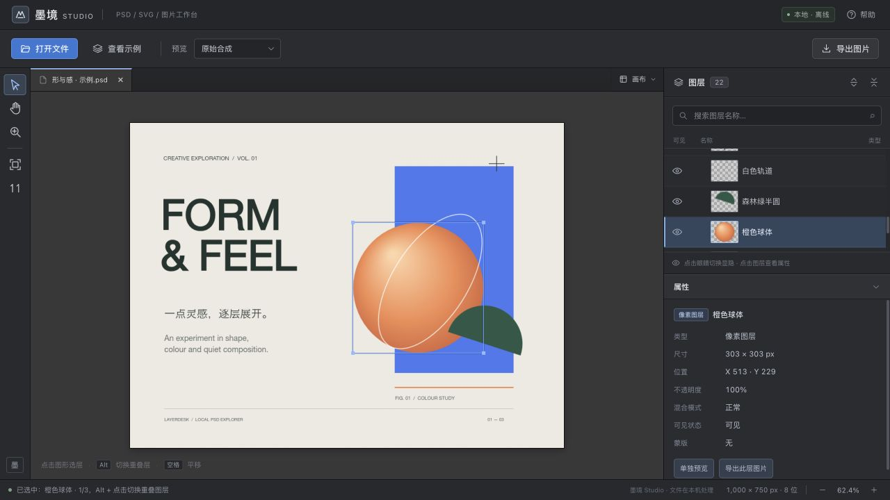

# Mojing Studio

**An offline PSD / SVG viewer and local image workbench in one HTML file.** Inspect layers, click artwork to select a layer, export assets, or adjust ordinary images. Files are processed in your browser.

[简体中文](README.md) · [Release guide](docs/PUBLISHING.md)



## Features

- PSD / PSB layer trees, SVG element trees, visibility and canvas picking.
- Multiple document tabs with independent view and image-adjustment state.
- PNG / JPEG export, output size, JPEG background and optional text watermarks.
- Seven image presets including a gentle portrait tone; brightness, contrast, saturation, temperature, sharpening and overall strength.
- Temporary original-image comparison and reset. The source file is preserved.
- A standalone HTML distribution with bundled runtime code and no runtime script downloads.

## Supported scope

Open PSD, PSB, SVG and browser-supported PNG, JPEG, WebP, GIF, BMP or AVIF images. This public edition does not parse Illustrator `.ai` or PDF files.

PSD and SVG inspection does not include painting, text editing, cropping, moving layers or saving edited source documents. Complex effects, smart objects, masks, blend options and approximate CMYK previews can differ from the authoring software. Animated images use a static frame. Browser memory and canvas limits apply; image export is limited to 64 million pixels.

## Run and build

Use Node.js 20+:

```sh
npm ci
npm test
npm run dev
```

Open the printed local URL. The development server listens on loopback only.

```sh
npm run build
npm run release
```

`dist/index.html` and `dist/墨境Studio.html` contain the same offline application. `release/` contains the downloadable HTML and notices. Generated distributions are excluded from Git. Recent desktop Chrome or Edge is recommended; if a browser restricts local-file workers, use the local server.

The browser verification pages under `tests/` use self-generated fixtures. See the Chinese README for the available routes. Source PSD and image fixture generators are included; no client documents, private sample routes or external stock photos are shipped.

## License and contributions

Application code: [MIT](LICENSE). Bundled components retain their own licenses; see [third-party notices](THIRD_PARTY_NOTICES.md).

See [CONTRIBUTING.md](CONTRIBUTING.md) to report issues or contribute. Provide browser information, the exact error and a minimal sample that you have permission to publish. Do not upload confidential documents.
