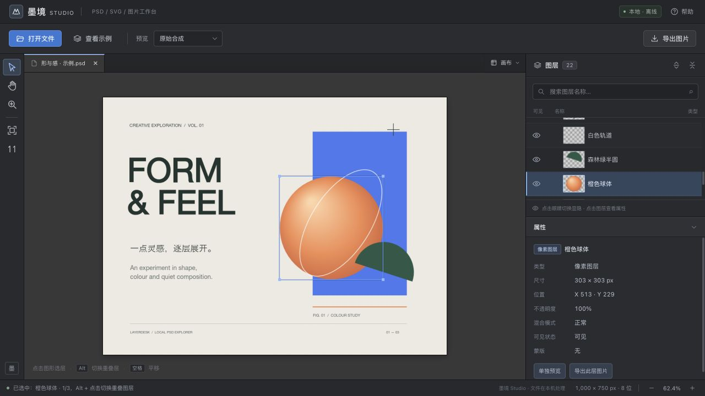

# 墨境 Studio · Mojing Studio

**一个可离线使用的 PSD / SVG / 图片工作台。** 打开设计文件、点击画布定位图层、导出素材，或为普通图片应用滤镜和水印。文件在浏览器内处理。

[English](README.en.md) · [GitHub 仓库](https://github.com/yierzaizhe/mojing-studio) · [功能与限制](#功能与限制) · [开发](#本地开发) · [发布说明](docs/PUBLISHING.md)



## 开始使用

[下载 v1.0.0 单文件 HTML](https://github.com/yierzaizhe/mojing-studio/releases/download/v1.0.0/mojing-studio-v1.0.0.html) · [下载离线 ZIP](https://github.com/yierzaizhe/mojing-studio/releases/download/v1.0.0/mojing-studio-v1.0.0-offline.zip) · [v1.0.0 Release 页面](https://github.com/yierzaizhe/mojing-studio/releases/tag/v1.0.0)

下载 `mojing-studio-v1.0.0.html` 后，用近期桌面 Chrome / Edge 打开；ZIP 另附使用说明和许可证，解压后打开其中的 `墨境Studio.html`。通过“打开文件”或拖放导入 PSD、PSB、SVG、PNG、JPG、WebP、GIF、BMP、AVIF；具体图片解码格式取决于浏览器。可一次导入多份文件，每份文件有独立标签。

若浏览器限制直接打开本地文件中的 Worker，可用下方开发命令启动仅本机可访问的预览服务。

## 能做什么

- **检查图层与元素**：保留 PSD 图层分组、名称、文字信息与显隐；SVG 按分组及可视元素显示结构。
- **点击画布选层**：按实际透明像素定位；Alt / Option + 重复点击可切换重叠内容。
- **查看与导出**：原图、当前显隐合成或选中图层预览；导出透明 PNG 或带底色的 JPG，支持输出尺寸与可选文字水印。
- **调整普通图片**：七款预设、亮度/对比度/饱和度/色温/锐化、整体强度，按住对比原图和恢复默认。
- **同时打开多个文档**：每张图片保留自己的参数、画面、缩放与选层状态；参数仅保留在当前页面会话。
- **完整离线产物**：单个 HTML 包含本版运行组件，运行时不需要下载脚本；网络连接受页面 CSP 限制。

图片滤镜：自然增强、明亮通透、清晰质感、柔和暖调、冷色清爽、经典黑白、人像柔和。人像预设进行轻微提亮与暖调、柔和对比。滤镜在 PNG / JPG 导出前处理，水印随后叠加；PNG 保留透明度。

## 功能与限制

本公开版支持 **PSD / PSB、SVG 和普通图片**，不提供 `.ai` 或 PDF 解析。

PSD 与 SVG 用于查看、选层、显隐和图片导出，不提供画笔、文字改写、裁剪、移动图层或 PSD/SVG 源文件回写；界面只显示已经实现的功能。

PSD 文字和智能对象主要使用文件保存的像素缓存。复杂图层样式、调整图层、智能滤镜、部分蒙版与混合选项可能与原软件不同。缺少独立缓存的节点保留名称和属性，并说明单层预览不可用。CMYK 为近似 RGB 预览，未做印刷色彩管理。

SVG 保留常见矢量效果；脚本、事件与 `foreignObject` 不执行，外链素材需要预先嵌入。动态图片按静态首帧处理。图像解码和画布上限由浏览器及设备内存限制；图片导出预算为 6400 万像素，超出时请选择缩小尺寸。

## 本地开发

需要 Node.js 20 或更新版本。构建运行产物本身使用 Node 标准库和仓库内的浏览器解析组件；测试另需安装锁定的开发依赖。

```sh
npm ci
npm test
npm run dev
```

浏览器打开终端给出的 `http://127.0.0.1:4173`。服务仅监听本机；可用 `PORT` 更改端口。

```sh
npm run build
```

产物在 `dist/index.html`、`dist/墨境Studio.html`，内容相同。`dist/` 不进入 Git 历史。

## 验证

`npm test` 先构建，再检查文件读取、透明像素命中、剪贴合成、图片滤镜、PNG/JPG 编码、水印、空图层处理，以及公开版格式拒绝与依赖清理。

启动本机服务后，可运行以下真实浏览器验收页：

- `/tests/public-browser-check.html`：公开版格式拒绝、混合导入和真实控件。
- `/tests/browser-check.html`：PSD 读取、图层与像素合成。
- `/tests/svg-browser-check.html`：SVG 渲染、选层与导出。
- `/tests/image-browser-check.html`：图片格式、透明度与方向。
- `/tests/image-filters-browser-check.html`：七组预设、参数、原图对比、逐标签恢复、滤镜与水印导出。
- `/tests/tabs-browser-check.html`：混合文档导入、切换、关闭与恢复。
- `/tests/psd-file-read-browser-check.html`：读取失败回退、取消及队列恢复。

仓库提供自制样例和生成脚本。不存在开发机专用的客户样本路由。测试通过代表这些样例覆盖的行为，不代表所有设计文件都能完整还原。

本次本机验收记录见 [验证记录](docs/VALIDATION.md)。

## 项目结构

```text
src/       应用、图片滤镜、适配器、Worker 与自制示例
vendor/    固定的浏览器 PSD 组件及许可证
scripts/   测试与离线发布脚本
tests/     合成样例与检查
docs/      自制示例截图与发布说明
dist/      生成的独立 HTML（忽略）
release/   生成的交付文件（忽略）
```

## 授权与反馈

应用代码采用 [MIT](LICENSE)，第三方组件保留各自授权，见 [THIRD_PARTY_NOTICES.md](THIRD_PARTY_NOTICES.md)。

报告问题请注明浏览器、文件格式、报错文字和复现步骤；优先提供可以公开的最小样例。请勿直接上传保密文件。贡献说明见 [CONTRIBUTING.md](CONTRIBUTING.md)。
